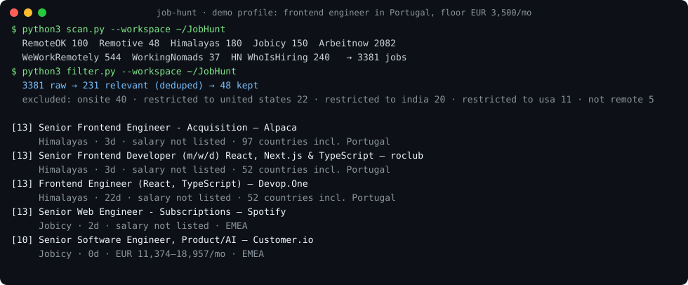

# job-hunt: a Claude Code skill for an honest, low-noise job search

[](https://github.com/luisedu/job-hunt-skill/actions/workflows/tests.yml)

A [Claude Code](https://claude.com/claude-code) skill that runs your job search from a local folder of Markdown files:

- **Scans 11 public job boards** (RemoteOK, Remotive, Himalayas, Jobicy, We Work Remotely, Working Nomads, HN "Who is hiring", Arbeitnow, GetOnBoard, Gupy, and optionally Remote Rocketship).
- **Watches companies' own job boards** (Greenhouse, Ashby, Lever, Workable) for the companies you list, so you see openings the day they are posted. `--probe-ats` finds each company's board.
- **Filters out the noise** most job tools ignore:
  - "remote" jobs that only hire in another country
  - ghost jobs (stale, reposted, talent pools)
  - pay below your floor (converted from any currency)
  - duplicates across boards
- **Flags likely scams:** free-mail recruiters, fees, Telegram/WhatsApp-only contact, implausible pay, unnamed companies.
- **Ranks by fit** against your profile, then Claude vets every job by reading it.
- **Tailors CV and cover-letter PDFs** using only facts from your CV, with a "do not claim" list to keep it honest.
- **Tracks applications** and asks you, now and then, whether you've heard back.
- **Logs outcomes** in an append-only event log: every filter decision, every skip (with your reason), every stage, and check-ins at 30/90/180/365 days after a hire. It saves each posting when you apply, so you can later check whether the job matched what was advertised.
- **Learns carefully:** a correction becomes a rule only after you approve it (your words are stored verbatim). `calibrate` checks whether the fit score predicts interviews, and shows "n too small" instead of a fake percentage.
- **Preps AI-scored interviews** (audio bots, one-way video): answer rules, a numbers bank and mock runs.

It **never applies, emails or messages anyone for you.** You stay in control of every application.



<sub>Real run with the example profile in `examples/`: 3,381 postings from 8 boards → 48 kept. Onsite jobs and "remote" roles restricted to the US, India and elsewhere were removed automatically.</sub>

## Install

```bash
git clone https://github.com/luisedu/job-hunt-skill
ln -s "$PWD/job-hunt-skill/skill/job-hunt" ~/.claude/skills/job-hunt
```

Requirements: Python 3.11+, `curl`, `pdftotext` (poppler-utils) and LibreOffice (`soffice`) for PDF output.

## Use

Open Claude Code in an empty folder (e.g. `~/JobHunt`) and say:

> Set up my job hunt. My CV is at ~/Downloads/cv.pdf

Claude reads your CV and asks a few questions: target role, where you live, which regions can hire you, and your pay floor. It then creates the workspace:

```
JobHunt/
├── CLAUDE.md              loads the context every session
├── memory.md              hard rules (remote only, pay floor, exclusions…)
├── applications.md        tracker
├── curriculum/            your CV + profile.md (allowed facts, do-not-claim list)
├── search/filters.md      tunable filters (a JSON block the scripts read)
├── search/sources.md      job-board notes
├── search/scan-log.md     scan history
├── interview/             stories, salary notes, company prep
└── <company>/             tailored PDFs
```

After that:

| Say | What happens |
|---|---|
| "Any new jobs?" | Full scan → filter → Claude vets → ranked list with reasons for every exclusion |
| "Tailor my CV for <link>" | Maps requirements to your facts, asks about gaps, writes PDFs |
| "I applied to X" / "X replied" | Tracker updated |
| "Prep me for the X interview" | Company research, role → evidence map, honest answers for gaps, questions to ask |
| "Only show EU jobs above €4k" | Rules + filters updated, change logged |

Scripts also run on their own:

```bash
python3 skill/job-hunt/scripts/scan.py   --workspace ~/JobHunt
python3 skill/job-hunt/scripts/filter.py --workspace ~/JobHunt
```

## Configuration

All tuning lives in `search/filters.md` in your workspace (see its field guide): queries, title/description keywords, allowed regions, pay floor, ghost-job limits, fit weights, enabled sources. An example: `examples/answers-frontend-portugal.json`.

## Privacy

Your workspace contains your CV, salary expectations and application history. The workspace `.gitignore` ignores everything by default. **Don't commit it.** The scripts only call public job-board APIs and an FX-rate API (frankfurter.app). Nothing about you is sent anywhere.

## Sources and terms

Only public APIs and RSS feeds are used. LinkedIn, Indeed, Glassdoor and Wellfound are intentionally not scraped: search those manually. Remote Rocketship needs your own API key (`~/.config/remoterocketship/api-key`). Job-board endpoints change, so the notes are in `templates/search/sources.md` and PRs are welcome.

## Tests

```bash
python3 -m unittest discover -s tests -v    # offline, synthetic jobs
```

## License

MIT
