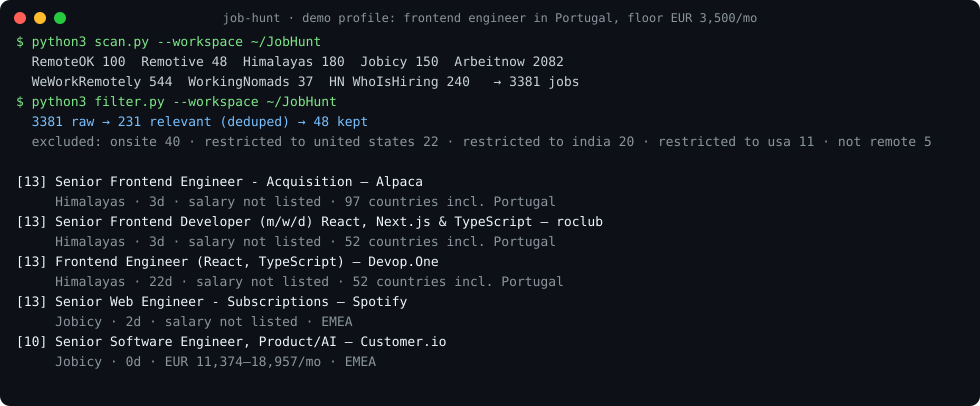

# job-hunt: uma skill do Claude Code para uma busca de emprego honesta e sem ruído

[English](README.md) | **Português**

[](https://github.com/luisedu/job-hunt-skill/actions/workflows/tests.yml) 

Uma skill do [Claude Code](https://claude.com/claude-code) que conduz sua busca de emprego a partir de uma pasta local de arquivos Markdown:

- **Varre sites de vagas públicos** (RemoteOK, Remotive, Himalayas, Jobicy, We Work Remotely, Working Nomads, HN "Who is hiring", Arbeitnow, GetOnBoard e, opcionalmente, Remote Rocketship com sua própria chave).
- **Acompanha as páginas de vagas das próprias empresas** (Greenhouse, Ashby, Lever, Workable) que você listar, para você ver as vagas no dia em que são publicadas. `--probe-ats` encontra a página de cada empresa.
- **Responde "eles podem me contratar, e quanto vou receber líquido?"** Cada vaga recebe um veredito de elegibilidade que separa *residência* de *direito de trabalhar* (passaporte não é endereço), identifica o tipo de contrato (folha local, PJ, contractor, employer of record) e a sobreposição de fuso horário, e estima o **salário líquido mensal** por contrato. O Brasil (CLT, PJ, exportação de serviços) é o primeiro módulo de país; os outros países usam taxas fixas que você define.
- **Verifica se uma empresa é real:** idade do domínio, configuração de e-mail, site, página pública de vagas, e-mail do recrutador, LEI e o cadastro de CNPJ, combinados numa nota de confiança explicada. Nunca diz "seguro".
- **Transforma seu histórico em decisões:** quais empresas seguem publicando vagas que você pode aceitar (e suas páginas de vagas), a taxa de resposta e o formato de entrevista de cada empresa, as habilidades mais pedidas que você não tem e quais pagam melhor, e um resumo semanal da busca com uma sugestão concreta.
- **Compara propostas** (CLT vs. PJ vs. contrato estrangeiro) por salário líquido, benefícios e **risco cambial**: o líquido se o câmbio variar ±10–20% e dentro da faixa real dos últimos 12 meses, além do salário CLT que equivaleria a cada contrato.
- **Filtra o ruído** que a maioria das ferramentas ignora:
  - vagas "remotas" que só contratam em outro país
  - vagas fantasma (antigas, republicadas, banco de talentos)
  - salário abaixo do seu piso (convertido de qualquer moeda)
  - vagas duplicadas entre sites
- **Sinaliza prováveis golpes:** recrutador com e-mail gratuito, cobrança de taxas, contato só por Telegram/WhatsApp, salário implausível, empresa sem nome.
- **Ordena por aderência** ao seu perfil, e depois o Claude lê e confere cada vaga.
- **Adapta currículo e carta de apresentação em PDF** usando só fatos do seu currículo, com uma lista do que "não afirmar" para manter tudo honesto.
- **Confere cada currículo como um ATS o lê:**
  - leitura: texto selecionável, contatos, títulos de seção, datas, linhas coladas, fontes
  - as palavras-chave da vaga, separadas em já no currículo / faltando mas verdadeiras / não são suas
  - aderência do título à vaga
  - as perguntas de triagem onde acontece a maioria das rejeições automáticas
  Nunca sugere texto oculto nem afirmar habilidades que você não tem.
- **Acompanha as candidaturas** e pergunta, de vez em quando, se você teve resposta.
- **Registra resultados** num log de eventos só de acréscimo: cada decisão do filtro, cada vaga descartada (com o seu motivo), cada etapa, e check-ins 30/90/180/365 dias após uma contratação. Salva cada vaga quando você se candidata, para depois conferir se o trabalho era o anunciado.
- **Aprende com cuidado:** uma correção só vira regra depois que você aprova (suas palavras ficam registradas literalmente). `calibrate` verifica se a nota de aderência prevê entrevistas, e mostra "n pequeno demais" em vez de uma porcentagem falsa.
- **Prepara entrevistas avaliadas por IA** (bots de áudio, vídeo gravado): regras de resposta, um banco de números e simulações.

Ela **nunca se candidata, envia e-mail ou mensagem a ninguém por você.** Você controla cada candidatura.



<sub>Execução real (2026-11-25) com `examples/answers-frontend-portugal.json`: 3.165 vagas de 8 sites → 243 relevantes → 50 mantidas. Vagas presenciais e vagas "remotas" restritas aos EUA, Índia e outros lugares foram removidas automaticamente. Recrie com `docs/make_demo.py`. Outros perfis de exemplo: um engenheiro de dados na Argentina e um product designer na Espanha.</sub>

## Instalação

Como plugin do Claude Code (recomendado; atualiza com `/plugin update`):
```text
/plugin marketplace add luisedu/job-hunt-skill
/plugin install job-hunt@job-hunt-skill
```
Ou a partir de um clone:
```bash
git clone https://github.com/luisedu/job-hunt-skill
ln -s "$PWD/job-hunt-skill/skill/job-hunt" ~/.claude/skills/job-hunt
```

Requisitos: Python 3.11+, `curl`, poppler (`pdftotext`, `pdfinfo`, `pdffonts`, `pdftoppm`) e LibreOffice para gerar PDFs.

## Status: beta

Usada diariamente numa busca real (um engenheiro de Visão Computacional remoto no Brasil, em Linux) e coberta por testes offline com perfis de exemplo em Portugal, Espanha e Argentina. Espere arestas em outros cenários, e por favor [abra uma issue](https://github.com/luisedu/job-hunt-skill/issues/new/choose).

Limitações conhecidas:
- **Testada só em Linux.** macOS e Windows devem funcionar (os scripts procuram o LibreOffice nos locais habituais), mas ninguém confirmou ainda.
- **Salário líquido:** só o Brasil tem um módulo de impostos de verdade (CLT, PJ, exportação de serviços). Os outros países usam as taxas líquidas fixas que você define em `filters.md` → `person.netRates`: uma referência aproximada, não um cálculo. Para adicionar seu país: [docs/netpay-countries.md](docs/netpay-countries.md).
- **Principalmente vagas remotas.** Os sites embutidos listam trabalho remoto. Para vagas híbridas ou presenciais, adicione as páginas de vagas de empresas locais (`atsBoards`) e pesquise no LinkedIn você mesmo.
- **Sites de vagas mudam sem aviso.** Quando uma fonte retorna 0 vagas, a varredura avisa; confira `search/sources.md` e reporte.
- **Sem sites que exigem login:** LinkedIn, Indeed, Glassdoor e Wellfound são pesquisados por você, de propósito.

## Uso

Abra o Claude Code numa pasta vazia (por exemplo `~/JobHunt`) e diga:

> Configure minha busca de emprego. Meu currículo está em ~/Downloads/cv.pdf

O Claude lê seu currículo e faz algumas perguntas: cargo desejado, onde você mora, quais regiões podem te contratar e seu piso salarial. Depois cria o espaço de trabalho:

```
JobHunt/
├── CLAUDE.md              carrega o contexto em toda sessão
├── memory.md              regras fixas (só remoto, piso salarial, exclusões…)
├── applications.md        acompanhamento das candidaturas
├── curriculum/            seu currículo + profile.md (fatos permitidos, lista do que não afirmar)
├── search/filters.md      filtros ajustáveis (um bloco JSON lido pelos scripts)
├── search/sources.md      notas sobre os sites de vagas
├── search/scan-log.md     histórico das varreduras
├── interview/             histórias + banco de números, regras para entrevistas com IA, notas salariais, preparação por empresa
├── outcomes/              log de eventos (outcomes.jsonl) + vagas salvas quando você se candidata
└── <empresa>/             PDFs adaptados
```

Depois disso:

| Diga | O que acontece |
|---|---|
| "Tem vaga nova?" | Varredura completa → filtro → o Claude confere → lista ordenada, com o motivo de cada exclusão |
| "Adapte meu currículo para <link>" | Liga os requisitos aos seus fatos, pergunta sobre lacunas, gera os PDFs |
| "Me candidatei na X" / "A X respondeu" | Acompanhamento e log de resultados atualizados; a vaga é salva |
| "Descarta a X, o salário é baixo" | Registrado com o seu motivo. O Claude pergunta antes de transformar em regra |
| "Me prepare para a entrevista na X" | Pesquisa da empresa, mapa requisito → evidência, respostas honestas para lacunas, perguntas para fazer |
| "Simule minha entrevista com IA da X" | Perguntas prováveis, uma de cada vez, cada resposta avaliada pelas regras de entrevista com IA |
| "Acompanhe também a Acme e a Globex" | Encontra as páginas de vagas delas (`--probe-ats`) e inclui na varredura |
| "Como está minha busca?" | Funil (`stats`) e se a nota de aderência prevê entrevistas (`calibrate`) |
| "A Acme é confiável? O recrutador escreveu de um gmail" | `verify_company.py`: nota de confiança, motivos e próximos passos |
| "Compare essa proposta CLT com aquele contrato em dólar" | `netpay.py`: líquido mensal de cada uma, com as premissas |
| "Meu currículo passa no ATS para <link>?" | `ats_check.py`: problemas de leitura, palavras-chave faltando (só as verdadeiras para incluir), título, perguntas de triagem |
| "Compare minhas propostas" | `offers.py`: líquido, benefícios, cenários de câmbio, salário CLT equivalente |
| "Quais empresas contratam do meu país?" | `insights.py employers --suggest-ats` |
| "O que devo aprender agora?" | `insights.py skills`: lacunas em todas as vagas relevantes, e salário ligado a habilidades |
| "Como foi esta semana?" | `insights.py weekly`: funil por canal, follow-ups pendentes, uma sugestão |
| "Mostre só vagas na Europa acima de €4 mil" | Regras e filtros atualizados, mudança registrada |

Os scripts também rodam sozinhos:

```bash
python3 skill/job-hunt/scripts/scan.py   --workspace ~/JobHunt
python3 skill/job-hunt/scripts/filter.py --workspace ~/JobHunt     # also logs filter decisions
python3 skill/job-hunt/scripts/scan.py   --workspace ~/JobHunt --probe-ats acme,globex
python3 skill/job-hunt/scripts/outcomes.py --workspace ~/JobHunt stats       # or: calibrate
python3 skill/job-hunt/scripts/netpay.py   --workspace ~/JobHunt --gross 25000 --contract employee_local
python3 skill/job-hunt/scripts/verify_company.py --workspace ~/JobHunt --company Acme --domain acme.com
python3 skill/job-hunt/scripts/insights.py --workspace ~/JobHunt weekly        # or: employers, companies, skills
python3 skill/job-hunt/scripts/offers.py   --workspace ~/JobHunt               # reads interview/offers.json
python3 skill/job-hunt/scripts/ats_check.py --cv CV.pdf --posting posting.txt --workspace ~/JobHunt
```

## Configuração

Todo o ajuste fica em `search/filters.md` no seu espaço de trabalho (veja o guia de campos dele): buscas, palavras-chave de título e descrição, regiões permitidas, piso salarial, limites para vagas fantasma, pesos de aderência, fontes ativas, páginas de vagas de empresas a acompanhar (`atsBoards`) e vagas específicas a descartar sem excluir a empresa (`excludedRoles`). Exemplo: `examples/answers-frontend-portugal.json`.

## Privacidade

Seu espaço de trabalho guarda seu currículo, pretensão salarial, histórico de candidaturas, log de resultados e alguns dados sobre recrutadores e empresas. Ele fica no seu computador: o `.gitignore` dele ignora tudo por padrão. **Não faça commit nem publique.**

O que sai da sua máquina:
- **Seu assistente de IA** (por exemplo, o Claude) lê os arquivos do espaço de trabalho com que você trabalha, então eles são processados pelo provedor nos termos desse provedor. Não coloque no espaço de trabalho nada que você não compartilharia com ele.
- **Sites de vagas** recebem seus termos de busca (derivados do seu perfil), e o Remote Rocketship só os recebe se você adicionar sua própria chave de API.
- **Verificação de empresas** envia nomes de empresas e domínios para rdap.org, dns.google (então o Google vê quais domínios você consulta), api.gleif.org e brasilapi.com.br (só quando você informa um CNPJ).
- **A comparação de propostas e o filtro** enviam códigos de moeda para frankfurter.app.
- **Links de vagas** que você passa para `ats_check.py` são baixados desse site.
- Seu nome, currículo, contatos e salário nunca são enviados pelos scripts.

**Dados de outras pessoas.** Liste referências no currículo só com o consentimento delas, escreva cargos em vez de nomes no log de resultados, e use `outcomes.py redact "Nome"` se alguém pedir para ser removido.

**Para uso pessoal.** Uma busca de emprego que você faz para si mesmo é uso particular, em grande parte fora do GDPR (art. 2(2)(c)) e da LGPD (art. 4º, I). Se você usar a skill para outras pessoas, por exemplo como orientador de carreira, você é o controlador dos dados delas e essas leis se aplicam integralmente.

### Apagar seus dados
- Tudo: apague a pasta do espaço de trabalho (por exemplo `rm -rf ~/JobHunt`).
- Uma pessoa: `python3 skill/job-hunt/scripts/outcomes.py --workspace ~/JobHunt redact "Nome" "email@example.com"`, e remova-a de `interview/*.md`.
- Caches: `search/cache/` e `search/company-cache.json` no espaço de trabalho. Com Remote Rocketship: `~/.config/remoterocketship/`.

## Fontes e termos de uso

Todo relatório mostra a fonte e o link original de cada vaga: RemoteOK, Remotive e Jobicy exigem essa atribuição. Os dados das vagas são só para a sua busca pessoal, então não os republique. O Remotive pede no máximo 4 requisições por dia à API, por isso `scan.py` baixa o feed uma vez e guarda em cache por 6 horas. Só são usadas APIs e feeds RSS públicos, incluindo as APIs públicas de vagas do Greenhouse, Ashby, Lever e Workable para as empresas que você listar. LinkedIn, Indeed, Glassdoor e Wellfound não são raspados de propósito: pesquise neles manualmente. O Remote Rocketship precisa da sua própria chave de API (`~/.config/remoterocketship/api-key`). Os endereços dos sites de vagas mudam, então as notas ficam em `templates/search/sources.md` e PRs são bem-vindos.

## Aviso e uso aceitável

- **Para quem procura emprego, sobre a própria busca.** Não use para triar, ranquear ou rejeitar candidatos. Isso é uso de alto risco pela Política de Uso da Anthropic e por leis como o AI Act da UE, com obrigações que este projeto não cumpre.
- **Estimativas, não aconselhamento.** O salário líquido é uma estimativa assistida por IA, a partir de uma fórmula fixa, para comparar propostas. Não é aconselhamento tributário, jurídico ou migratório: decida a estrutura tributária com um contador e confirme o direito de trabalhar com o empregador.
- **Verificações de empresas são sinais, não acusações.** Uma nota baixa significa que os sinais públicos não confirmaram a empresa. Mantenha os resultados privados e não os publique como fatos sobre uma empresa.
- **Respeitar os termos dos sites é responsabilidade sua.** Os scripts usam APIs e páginas públicas cujos termos permitem isso, mostram a atribuição e respeitam limites de requisição. Fontes cujos termos proíbem agregação (por exemplo, a Gupy) vêm desligadas por padrão; ligar uma é decisão sua.
- **Candidaturas honestas.** A skill nunca inventa experiência nem adiciona palavras-chave ocultas, e você envia cada candidatura.
- Fornecida "no estado em que se encontra" sob a licença MIT, sem garantia.

## Testes

```bash
python3 -m unittest discover -s tests -v    # offline: filters, outcome log, calibration, job-board parsers, net pay, eligibility, company check, insights, offers, ATS check
```

## Licença

MIT
